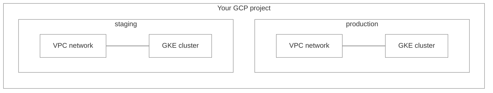
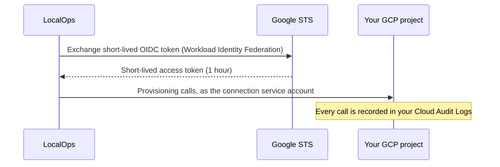
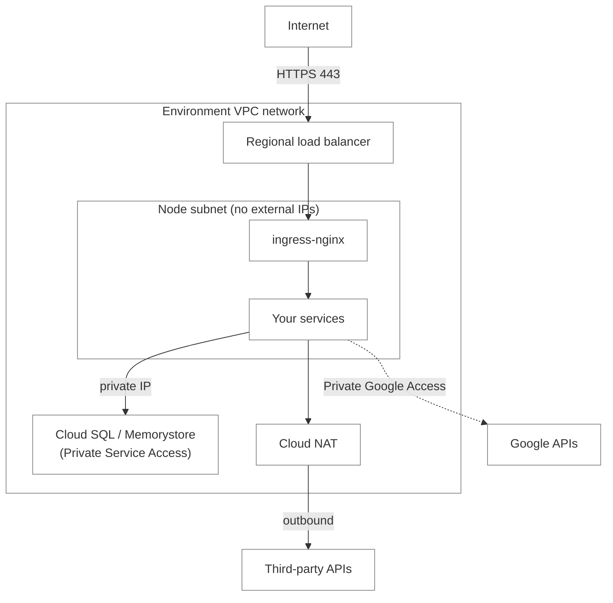
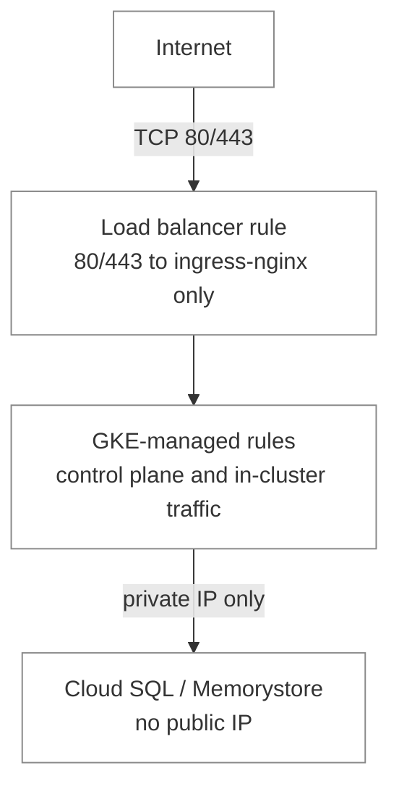
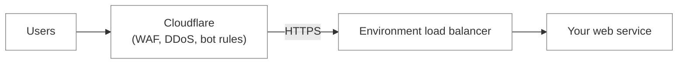
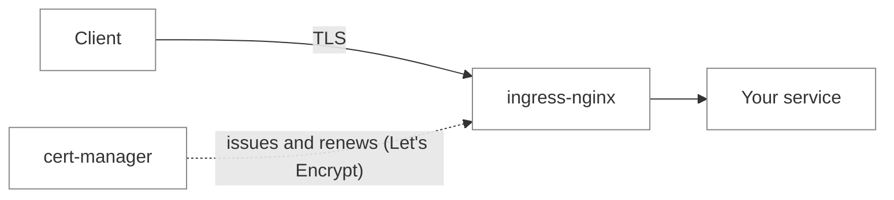
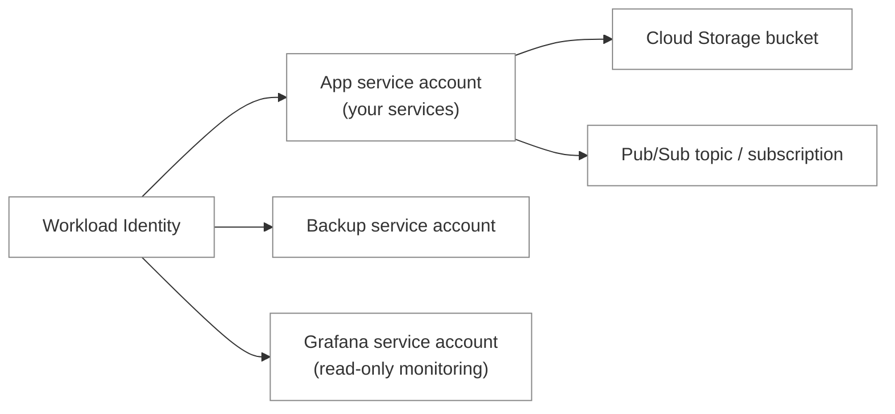
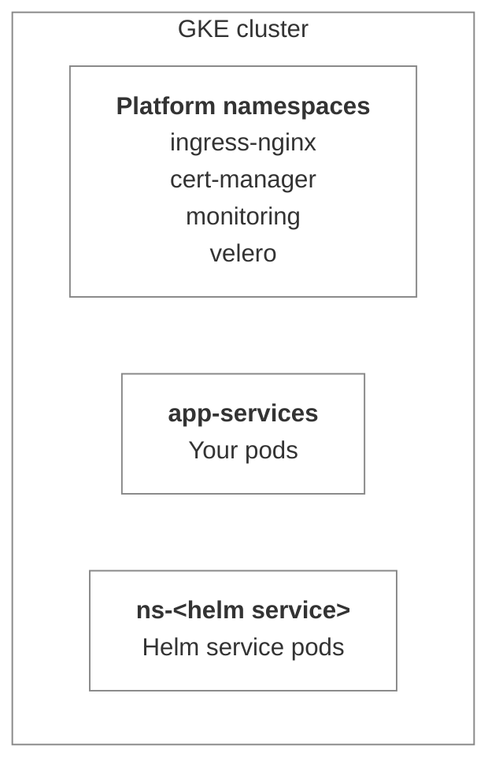
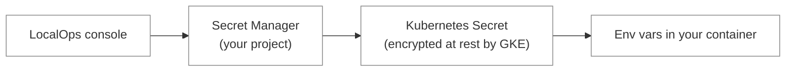
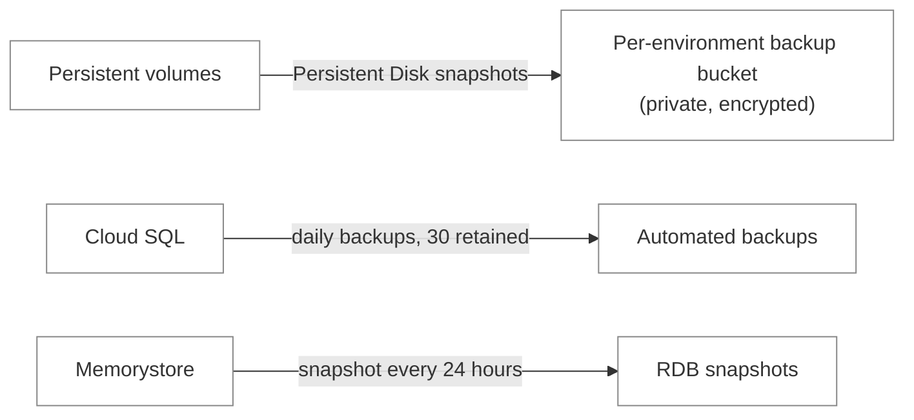

When we say a LocalOps environment is _production grade_, we mean a specific set of security controls is switched on for
every cluster we create, from the moment it is created. You don't configure them, and your services don't need code
changes to benefit from them.

This page walks through each of them for environments on Google Cloud.

<Note>
  This guide covers GCP environments. For AWS, see [Environment security controls on AWS](/environment/security).
</Note>

## Dedicated environment in your project

Every environment is its own single-tenant deployment inside your GCP project. It gets its own VPC network and its own
GKE cluster. No compute, network or Kubernetes control plane is shared with any other environment or any other customer.

For each cluster, LocalOps also turns on:

- **A highly available control plane.** Clusters are regional, so GKE runs the Kubernetes control plane across multiple
  zones in the region.
- **Workload Identity.** Pods get Google credentials only through a Kubernetes service account explicitly bound to a
  Google service account. No service account keys are created or mounted anywhere.
- **IAM-based cluster access.** Every request to the Kubernetes API server is authenticated with Google IAM and served
  over TLS. No static cluster credentials are issued.
- **Controlled upgrades.** The Kubernetes version changes only through a deliberate, reviewed rollout, never on its own.
  Node auto-repair stays on, so unhealthy nodes are still replaced automatically.
- **Isolated provisioning state.** Each environment, and each service inside it, is provisioned and tracked
  independently, so a change to one can never leak into or roll back another. Secret values in provisioning state are
  encrypted with KMS before they are stored.
- **Resource labels.** Your organisation's tags are applied as GCP labels to every resource that supports them,
  including the GKE cluster, node VMs and Cloud SQL instances, so cost allocation and label-based policies work out of
  the box.

## Keyless access to your cloud project

LocalOps never holds a service account key for your project. When you [connect a GCP project](/accounts/gcp), you create
a Workload Identity Federation pool and provider that trust LocalOps, plus a service account LocalOps may impersonate.
Each provisioning run exchanges a short-lived LocalOps token at Google STS and impersonates that service account.

- **Short sessions.** Access tokens last one hour and are minted fresh for every provisioning run. Credential files are
  written with owner-only permissions for the duration of the run and deleted afterwards.
- **Audience-pinned tokens.** Tokens LocalOps issues for GCP carry a dedicated audience, and your federation provider
  accepts only tokens for your connection.
- **Fully auditable.** Every call runs as the connection service account and shows up in your project's Cloud Audit
  Logs.
- **Revocable at any time.** Deleting the federation provider or the service account cuts off access immediately.
- **Only the APIs it needs.** LocalOps enables only the APIs the platform uses (Compute, GKE, Secret Manager, IAM,
  Service Networking, Cloud Storage, Pub/Sub, Cloud SQL Admin and Memorystore), and never disables them on teardown, so
  other workloads in your project aren't affected.

## Network isolation

Every environment gets its own custom-mode VPC network - no auto-created subnets - with one regional subnet for nodes.
Pods and Services use separate VPC-native ranges. You can pick a [custom CIDR](/environment/create) when creating the
environment so it doesn't overlap with networks you plan to peer with.

- **Private nodes.** Node VMs have no external IP addresses and can't be reached directly from the internet.
- **Private Google Access.** Nodes reach Google APIs - container images, Secret Manager, Cloud Storage - over internal
  IPs, without any public address.
- **One way in.** Public HTTP(S) traffic enters only through one regional load balancer in front of the environment's
  ingress-nginx. Your services are never exposed to the internet directly - only
  [web services](/environment/services/web) are routed through the ingress.
  [Internal services](/environment/services/internal), [workers](/environment/services/workers) and
  [cron jobs](/environment/services/cronjob) stay private.
- **Controlled egress.** All outbound internet traffic leaves through a regional Cloud NAT on a dedicated Cloud Router.
- **Private data services.** Cloud SQL and Memorystore are attached through Private Service Access on a reserved
  internal range peered to the environment's VPC. Cloud SQL instances have no public IP.
- **Per-service IP allowlist.** You can restrict a web service to a list of IPs or CIDR ranges, enforced at the ingress.
  Preview environments inherit the list of the service they preview, so a preview is never more open than the app
  itself. An invalid entry fails the deploy instead of shipping an unenforced rule.
- **Spoof-proof client IPs.** The load balancer passes the real client IP through, and the ingress ignores inbound
  `X-Forwarded-For` headers, so a client can't forge its address to slip past an IP allowlist. See
  [Client IP](/environment/services/client-ip).

## Firewall rules

The environment's VPC denies all inbound traffic by default. The only inbound rules are the ones GKE manages for its own
cluster, and LocalOps opens no additional ports.

| Rule                                           | Allows                               | Source                        |
| ---------------------------------------------- | ------------------------------------ | ----------------------------- |
| VPC implied rule                               | Deny all inbound, allow all outbound | -                             |
| GKE control plane (`gke-<cluster>-*-master`)   | Control plane to nodes               | Control plane range           |
| GKE in-cluster (`gke-<cluster>-*-vms`, `-all`) | Node to node, pod to pod             | Node subnet and pod range     |
| Load balancer (`k8s-fw-<hash>`)                | TCP `80` and `443` to ingress-nginx  | Anywhere                      |
| Load balancer health checks                    | Health probes to ingress-nginx       | Google health-check ranges    |
| Cloud SQL / Memorystore                        | Engine port                          | Environment VPC, over peering |

- **Deny by default.** Anything not explicitly allowed above is blocked.
- **One public entry point.** The load balancer rule is the only one open to the internet. To narrow it further for a
  web service, use the per-service IP allowlist, enforced at the ingress.
- **No stale rules.** Load balancer firewall rules GKE creates outside the cluster are removed when the environment is
  deleted, scoped to that environment's VPC.

<Tip>
  Connecting environments across VPCs, for example with VPC Network Peering, means adding an ingress firewall rule for
  the peer network's CIDR on the ports your services need.
</Tip>

### Web application firewall with Cloudflare

Firewall rules filter by IP and port. To filter by what's inside a request - SQL injection, bot traffic, layer 7 DDoS -
put Cloudflare in front of your web services and use its WAF. Cloudflare has a generous free plan that includes DDoS
protection and basic WAF rules, so you can start without paying anything.

1. [Sign up for Cloudflare](https://dash.cloudflare.com/sign-up) if you don't have an account yet.
2. Add your domain to Cloudflare and set up a [custom domain](/environment/services/custom-domain) for your web service.
3. Turn on the proxy (orange cloud) for that DNS record, so traffic flows through Cloudflare before it reaches your
   environment.
4. Set Cloudflare's SSL/TLS mode to **Full (strict)**. Your service already has a valid certificate, so traffic stays
   encrypted all the way to the environment.
5. Enable the WAF managed rules, rate limiting and bot protection you need in the Cloudflare dashboard.
6. Add [Cloudflare's IP ranges](https://www.cloudflare.com/ips/) to the web service's IP allowlist, so nobody can skip
   the WAF by calling your environment's load balancer directly.

Behind Cloudflare, read the visitor's IP from the `CF-Connecting-IP` header. See
[Client IP](/environment/services/client-ip).

## Encryption in transit

Every web service is served over HTTPS with its own certificate, issued and renewed automatically.

- **Automatic certificates.** Each web service gets a Let's Encrypt certificate for its default subdomain, and for every
  [custom domain](/environment/services/custom-domain) as soon as it is activated. The environment's Grafana host gets
  one too.
- **Self-renewing.** Certificates renew automatically about 30 days before they expire and are swapped in without a
  restart. Nobody rotates a certificate by hand, and nothing expires silently.
- **No shared wildcard, no DNS credentials.** Domain ownership is proven with HTTP-01 challenges served by the
  environment's own ingress. Each service has its own certificate and private key, stored as a Kubernetes Secret and
  encrypted at rest by GKE.
- **End-to-end TLS when you need it.** With [`ssl_passthrough`](/environment/services/ops-json#ssl-passthrough), the
  ingress hands the TLS stream to your app unterminated, for apps that must hold their own certificate.
- **TLS to cloud APIs.** All provisioning calls to Google Cloud and Kubernetes APIs go over TLS.

## Encryption at rest

Data written by your services and by LocalOps is encrypted at rest by Google, with no application changes.

| What                            | How it's encrypted                                                                 |
| ------------------------------- | ---------------------------------------------------------------------------------- |
| Persistent volumes (PVCs)       | Persistent Disks, encrypted with AES-256 by Google                                 |
| Node boot disks                 | Encrypted by Google                                                                |
| Kubernetes Secrets              | Encrypted at rest by GKE along with the rest of cluster state                      |
| Cloud SQL databases             | Storage and automated backups encrypted by Google                                  |
| Memorystore                     | Data and snapshots encrypted by Google                                             |
| Cloud Storage buckets           | Encrypted by Google, with uniform bucket-level access - IAM only, no ACLs          |
| Pub/Sub                         | Messages encrypted by Google                                                       |
| Environment and service secrets | Secret Manager in your project, encrypted at rest and replicated                   |
| Database credentials            | Generated by LocalOps and stored in Secret Manager in your project                 |
| Backup bucket                   | Encrypted by Google, with uniform bucket-level access and public access prevention |

## Least-privilege IAM

Every component in the environment that needs Google access gets its own Google service account, usable only by the one
Kubernetes service account that needs it.

- **Workload Identity everywhere.** Each Google service account is bound to exactly one namespace and Kubernetes service
  account. No service account keys exist.
- **Node identity is hidden from pods.** Node pools run the GKE metadata server, so pods receive only their own Workload
  Identity credentials and can't read the node's identity.
- **App service account starts empty.** Your services' Google service account has no roles at creation. Each dependency
  you declare in [`ops.json`](/environment/services/ops-json) grants a role on that one resource.
- **Scoped platform accounts.** The backup service account can only touch this environment's backup bucket, and uses a
  custom role with just the eight disk and snapshot permissions it needs. The Grafana service account is read-only.

What each declared dependency grants:

| Dependency           | Access granted to your services                                      |
| -------------------- | -------------------------------------------------------------------- |
| Cloud Storage bucket | Object read/write on that bucket only                                |
| Pub/Sub topic        | Publish and view on that topic only                                  |
| Pub/Sub subscription | Subscribe on that subscription only                                  |
| Cloud SQL            | No IAM access - reached over a private IP with a password            |
| Memorystore          | No IAM access - reachable over a private IP from inside the VPC only |

<Note>
  All services in an environment share the environment's app service account, so the environment is the IAM isolation
  boundary. Put workloads that must not share cloud access in separate environments.
</Note>

## Kubernetes access control

- **IAM-authenticated cluster access.** Every call to the Kubernetes API is authenticated with Google IAM using freshly
  minted short-lived tokens. LocalOps stores no long-lived cluster credentials.
- **Your pods can't read the cluster.** The service account your pods run as can only manage leader-election leases.
  Pods can't list or read Secrets, or any other object, through the Kubernetes API.
- **Platform components are separated.** ingress-nginx, cert-manager, monitoring and backups each run in their own
  namespace, apart from your workloads.
- **Helm services get their own namespace.** Every [Helm chart service](/environment/services/helm-charts) installs into
  its own namespace with its own image pull secret, app secret, service account and Workload Identity binding.

## Compute and workloads

- **GKE node pools.** Nodes run on GKE's Container-Optimized OS for Linux, with optional Windows Server pools that only
  Windows workloads can land on. On-demand or Spot VMs, with autoscaling within the bounds you set.
- **Node auto-repair.** GKE automatically recreates nodes that fail health checks.
- **Workload placement.** Every service is pinned to the node pool you choose, so sensitive workloads can run on their
  own nodes.
- **No privileged containers by default.** A container runs privileged only if its
  [`ops.json`](/environment/services/ops-json#privileged-containers) asks for it, an admin has allowed privileged pods
  on the cloud connection, and the service isn't a preview. Otherwise it deploys unprivileged and the refusal is noted
  in the deploy log.
- **Isolated services.** Each service owns its own Kubernetes objects, certificate, secrets and cloud dependencies, and
  is deployed independently. A failed or rolled-back deploy of one service never touches another.
- **Safe rollouts.** Deploys wait for the new version to become ready before completing. Helm releases are atomic and
  clean up after themselves on failure. Identity fields of databases, like version, database name and username, are
  locked against accidental replacement.
- **Resource limits and health checks.** CPU and memory requests and limits are set per service, and
  [health checks](/environment/services/ops-json) restart unhealthy containers.

## Secrets handling

- **Stored in your project.** [Secrets](/environment/services/secrets) you add in the console are stored in Secret
  Manager in your GCP project.
- **Never in the pod spec.** Values reach your container as environment variables through Kubernetes Secret references.
  They are never written into the pod definition.
- **Scoped per service.** A pod receives only its own service's secrets, environment-wide shared secrets, and secrets of
  services it explicitly imports. It never sees another service's secrets implicitly.
- **Generated credentials stay secret.** Database passwords are never logged. They are stored in Secret Manager and
  delivered through a per-service Secret.
- **Registry credentials per namespace.** Image pull credentials live as a Secret in each namespace that needs them.

## Backups and recovery

- **Cluster and volume backups.** Every environment has a backup tool installed with its own private Cloud Storage
  bucket and Persistent Disk snapshots. Snapshots are retained, and the bucket outlives the environment. See
  [Backup & restore](/environment/backups-restore).
- **Cloud SQL.** Daily automated backups with 30 retained, plus Query Insights. High availability, with a standby in
  another zone, is available.
- **Memorystore.** RDB snapshots every 24 hours.

## Logs, metrics and audit

- **Application logs.** Container logs are collected into an in-cluster Loki with 30-day retention. See
  [Logs](/environment/monitoring/logs).
- **Metrics.** An in-cluster Prometheus keeps 30 days of metrics. Grafana is served over TLS on the environment's
  monitoring host, behind a login, with a read-only Cloud Monitoring data source for managed services. See
  [Metrics](/environment/monitoring/metrics).
- **Cloud API audit.** Every action LocalOps takes in your project runs as the connection service account and is
  recorded in your Cloud Audit Logs. Admin Activity logs are always on.

<Info>
  [Preview environments](/use-cases/ephemeral) get the same cluster-level controls, with a few deliberate differences to
  keep them cheap and disposable: preview services never run privileged, and preview Cloud SQL and Memorystore skip
  backups and snapshots. For who owns what, see [Shared responsibilities](/environment/shared-responsibilities).
</Info>
