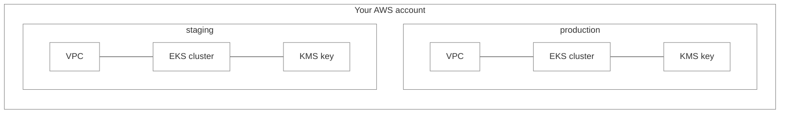
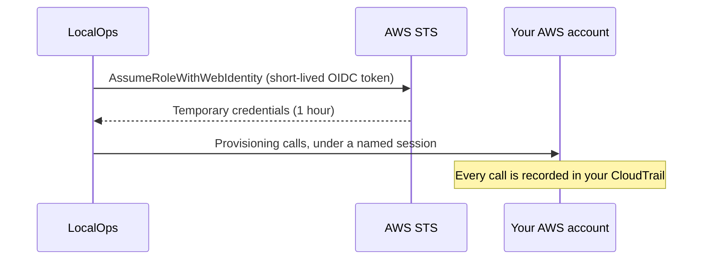
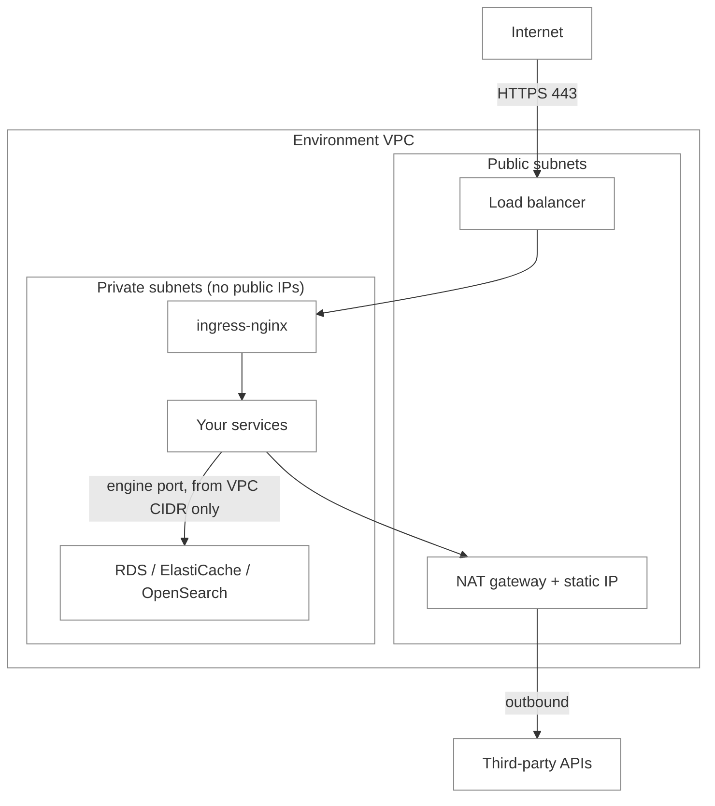
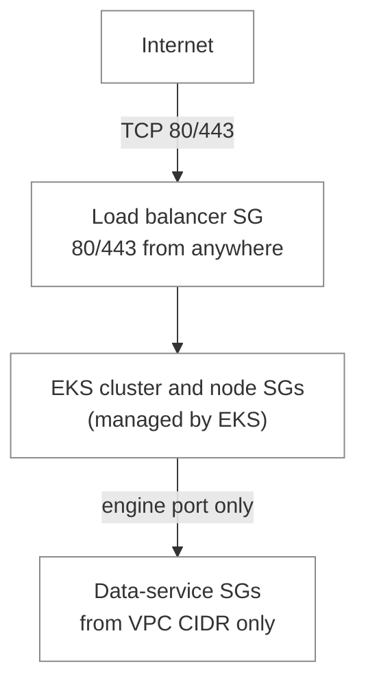
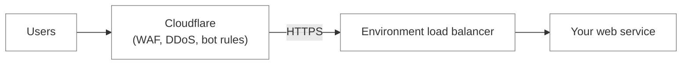
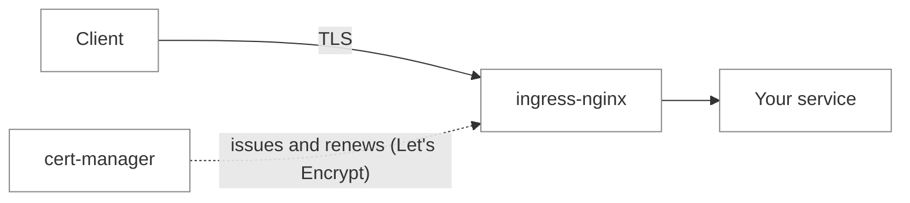
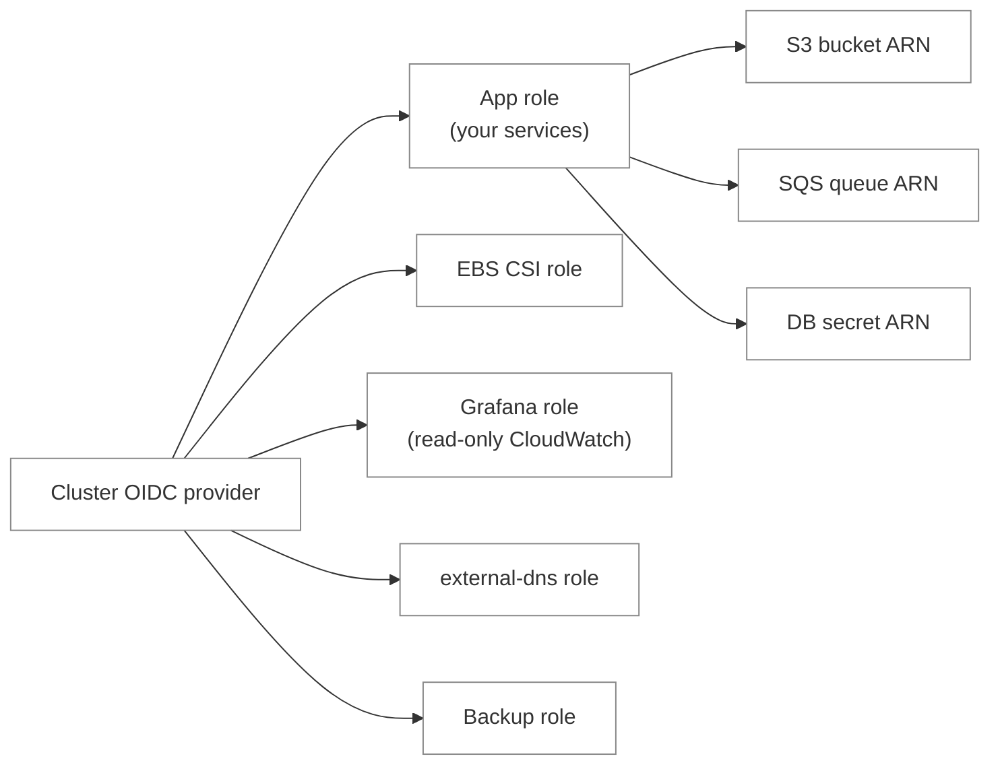
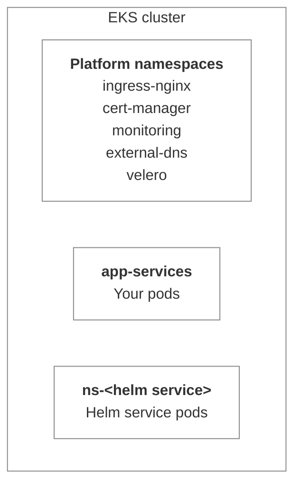
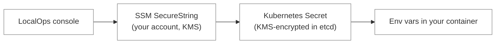
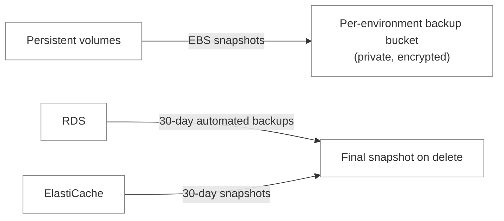

When we say a LocalOps environment is _production grade_, we mean a specific set of security controls is switched on for
every cluster we create, from the moment it is created. You don't configure them, and your services don't need code
changes to benefit from them.

This page walks through each of them for environments on AWS.

<Note>
  This guide covers AWS environments. For GCP, see [Environment security controls on GCP](/environment/security-gcp).
</Note>

## Dedicated environment in your account

Every environment is its own single-tenant deployment inside your AWS account. It gets its own VPC and its own EKS
cluster. No compute, network or Kubernetes control plane is shared with any other environment or any other customer.

For each cluster, LocalOps also turns on:

- **A customer-managed KMS key per cluster.** EKS encrypts every Kubernetes Secret in etcd with it. Only your account,
  the provisioning role and the EKS cluster role can use the key.
- **Control-plane audit logging.** EKS ships `api`, `audit`, `authenticator`, `controllerManager` and `scheduler` logs
  to CloudWatch Logs in your account.
- **IAM-based cluster access.** Access to the Kubernetes API is managed as IAM principals through EKS access entries,
  not through hand-edited `aws-auth` entries. Every request to the API server is authenticated with AWS IAM and served
  over TLS.
- **Isolated provisioning state.** Each environment, and each service inside it, is provisioned and tracked
  independently, so a change to one can never leak into or roll back another. Secret values in provisioning state are
  encrypted with KMS before they are stored.
- **Resource tagging.** Your organisation's tags are applied to every AWS resource, including EC2 instances, volumes and
  network interfaces, so cost allocation and tag-based policies work out of the box. See
  [AWS resource tags](/environment/infra-resources/aws).

## Keyless access to your cloud account

LocalOps never holds static AWS access keys for your account. When you connect an AWS account, you create an IAM role
with a CloudFormation template. LocalOps reaches your account only by exchanging a short-lived token from its OIDC
identity provider for temporary credentials on that role.

- **Short sessions.** Provisioning sessions last one hour. Token files exist only for the duration of a run and are
  deleted afterwards.
- **Pinned trust.** The role trusts only tokens issued for your connection's client ID, with the `sts.amazonaws.com`
  audience. A token for another connection can't assume it.
- **Fully auditable.** Every call runs under a named STS session and shows up in your CloudTrail.
- **Revocable at any time.** Deleting the CloudFormation stack removes the role and cuts off access immediately.

## Network isolation

Every environment gets a dedicated VPC with public and private subnets across up to three availability zones. You can
pick a [custom CIDR](/environment/create) when creating the environment so it doesn't overlap with networks you plan to
peer with.

- **Workloads in private subnets.** The EKS control-plane network interfaces, every node group, and RDS, ElastiCache and
  OpenSearch all sit in private subnets with no public IPs.
- **One way in.** Public HTTP(S) traffic enters only through one load balancer in front of the environment's
  ingress-nginx. Your services are never exposed to the internet directly - only
  [web services](/environment/services/web) are routed through the ingress.
  [Internal services](/environment/services/internal), [workers](/environment/services/workers) and
  [cron jobs](/environment/services/cronjob) stay private.
- **Static egress IP.** All outbound traffic leaves through a NAT gateway with an Elastic IP, so partners and SaaS
  vendors can allowlist your environment.
- **Locked-down data services.** Each RDS, ElastiCache and OpenSearch instance gets its own security group that accepts
  only its engine port, and only from the environment's VPC CIDR. See
  [Firewall / security groups](#firewall-/-security-groups).
- **Databases private by default.** RDS is not publicly accessible unless you ask for it - and even then, its security
  group still only accepts traffic from the VPC. OpenSearch is VPC-attached unless you explicitly make it public.
- **Per-service IP allowlist.** You can restrict a web service to a list of IPs or CIDR ranges, enforced at the ingress.
  Preview environments inherit the list of the service they preview, so a preview is never more open than the app
  itself. An invalid entry fails the deploy instead of shipping an unenforced rule.
- **Spoof-proof client IPs.** The load balancer passes the real client IP to the ingress over proxy protocol, and only
  the VPC CIDR is trusted to set it, so `X-Real-IP` and `X-Forwarded-For` can't be forged from the internet. See
  [Client IP](/environment/services/client-ip).
- **DNS record ownership.** When environments share a Route 53 zone, each environment can only update records it owns,
  so one environment can never rewrite another's.

## Firewall / security groups

Security groups are the firewall around each piece of the environment. LocalOps creates them so that only the load
balancer accepts traffic from the internet, and everything behind it accepts traffic only from inside the VPC.

| Security group                     | Protects                        | Inbound allowed                        |
| ---------------------------------- | ------------------------------- | -------------------------------------- |
| Load balancer                      | Environment's ingress           | TCP `80` and `443` from anywhere       |
| EKS cluster and node groups        | Kubernetes control plane, nodes | EKS defaults, nodes in private subnets |
| `rds-dep-<id>-<service>-sg`        | RDS PostgreSQL                  | TCP `5432` from the VPC CIDR           |
| `rds-dep-<id>-<service>-sg`        | RDS MySQL                       | TCP `3306` from the VPC CIDR           |
| `rds-dep-<id>-<service>-sg`        | RDS SQL Server                  | TCP `1433` from the VPC CIDR           |
| `cache-dep-<id>-<service>-sg`      | ElastiCache Redis / Valkey      | TCP `6379` from the VPC CIDR           |
| `cache-dep-<id>-<service>-sg`      | ElastiCache Memcached           | TCP `11211` from the VPC CIDR          |
| `opensearch-dep-<id>-<service>-sg` | OpenSearch (VPC mode)           | TCP `443` from the VPC CIDR            |

- **One group per dependency.** Every database, cache and search domain gets its own security group, opened only on its
  engine port. Nothing else on the instance is reachable.
- **VPC-only, even when public.** An RDS instance marked publicly accessible still only accepts traffic from the VPC
  CIDR through its security group.
- **Public OpenSearch is gated differently.** In public mode, OpenSearch gets no security group, and access is gated by
  HTTPS and fine-grained access control instead.
- **Finer filtering at the ingress.** The load balancer is the only group open to the internet. To narrow it further for
  a web service, use the per-service IP allowlist, enforced at the ingress.
- **Outbound is open.** Every group allows all outbound traffic, which leaves the VPC through the NAT gateway's static
  IP.

<Tip>
  Connecting environments across VPCs, for example with VPC peering, means adding inbound rules for the peer VPC's CIDR
  to the security group whose name contains `eks-cluster`.
</Tip>

### Web application firewall with Cloudflare

Security groups filter by IP and port. To filter by what's inside a request - SQL injection, bot traffic, layer 7 DDoS -
put Cloudflare in front of your web services and use its WAF. Cloudflare has a generous free plan that includes DDoS
protection and basic WAF rules, so you can start without paying anything.

1. [Sign up for Cloudflare](https://dash.cloudflare.com/sign-up) if you don't have an account yet.
2. Add your domain to Cloudflare and set up a [custom domain](/environment/services/custom-domain) for your web service.
3. Turn on the proxy (orange cloud) for that DNS record, so traffic flows through Cloudflare before it reaches your
   environment.
4. Set Cloudflare's SSL/TLS mode to **Full (strict)**. Your service already has a valid certificate, so traffic stays
   encrypted all the way to the environment.
5. Enable the WAF managed rules, rate limiting and bot protection you need in the Cloudflare dashboard.
6. Add [Cloudflare's IP ranges](https://www.cloudflare.com/ips/) to the web service's IP allowlist, so nobody can skip
   the WAF by calling your environment's load balancer directly.

Behind Cloudflare, read the visitor's IP from the `CF-Connecting-IP` header. See
[Client IP](/environment/services/client-ip).

## Encryption in transit

Every web service is served over HTTPS with its own certificate, issued and renewed automatically.

- **Automatic certificates.** Each web service gets a Let's Encrypt certificate for its default subdomain, and for every
  [custom domain](/environment/services/custom-domain) as soon as it is activated. The environment's Grafana host gets
  one too.
- **Self-renewing.** Certificates renew automatically about 30 days before they expire and are swapped in without a
  restart. Nobody rotates a certificate by hand, and nothing expires silently.
- **No shared wildcard, no DNS credentials.** Domain ownership is proven with HTTP-01 challenges served by the
  environment's own ingress. Each service has its own certificate and private key, stored as a Kubernetes Secret and
  encrypted with the environment's KMS key.
- **End-to-end TLS when you need it.** With [`ssl_passthrough`](/environment/services/ops-json#ssl-passthrough), the
  ingress hands the TLS stream to your app unterminated, for apps that must hold their own certificate.
- **TLS to managed services.** OpenSearch enforces HTTPS with TLS 1.2 or newer, with node-to-node encryption on. All
  provisioning calls to AWS, EKS and Kubernetes APIs go over TLS.

## Encryption at rest

Data written by your services and by LocalOps is encrypted at rest using AWS-native encryption, with no application
changes.

| What                            | How it's encrypted                                                      |
| ------------------------------- | ----------------------------------------------------------------------- |
| Persistent volumes (PVCs)       | Default `gp3-encrypted` StorageClass - every volume is encrypted EBS    |
| Kubernetes Secrets              | Envelope-encrypted with the environment's own customer-managed KMS key  |
| RDS databases                   | Storage encryption on every engine that supports it                     |
| OpenSearch domains              | Encryption at rest enabled                                              |
| S3 buckets                      | SSE-S3, with Block Public Access on and ACLs disabled                   |
| SQS queues                      | SSE-SQS                                                                 |
| Environment and service secrets | SSM Parameter Store `SecureString`, encrypted with KMS, in your account |
| Database master credentials     | AWS Secrets Manager                                                     |
| Backup bucket                   | SSE-S3 (AES-256)                                                        |

## Least-privilege IAM

Every component in the environment gets its own IAM role, trusted only by the one thing that needs it.

- **Workload identity everywhere.** Your services and every platform add-on use IAM Roles for Service Accounts (IRSA).
  Nothing borrows the node's role for cloud access. Each role's trust policy pins the exact namespace and service
  account that may assume it.
- **No static keys in your apps.** The AWS SDK picks up temporary credentials automatically. There are no access keys to
  rotate, leak or manage.
- **App role starts empty.** Your services' role has no permissions at creation. Each dependency you declare in
  [`ops.json`](/environment/services/ops-json) attaches a policy scoped to that one resource's ARN.
- **Scoped platform roles.** The cluster role is trusted only by EKS, and the node role only by EC2. The Grafana role is
  read-only and limited to the environment's region. The backup role can only touch this environment's backup bucket.

What each declared dependency grants:

| Dependency          | Access granted to your services                                     |
| ------------------- | ------------------------------------------------------------------- |
| S3 bucket           | Bucket listing and object read/write on that bucket only            |
| SQS queue           | Send, receive and delete messages on that queue only                |
| SNS topic           | Publish and subscribe on that topic only                            |
| RDS instance        | Read its master-credential secret only                              |
| OpenSearch domain   | Read its master-user secret, and HTTP access to that domain only    |
| ElastiCache cluster | No IAM access - reachable over the network from inside the VPC only |

<Note>
  All services in an environment share the environment's app role, so the environment is the IAM isolation boundary. Put
  workloads that must not share cloud access in separate environments.
</Note>

## Kubernetes access control

- **Your pods can't read the cluster.** The service account your pods run as can only manage leader-election leases.
  Pods can't list or read Secrets, or any other object, through the Kubernetes API.
- **Platform components are separated.** ingress-nginx, cert-manager, monitoring, external-dns and backups each run in
  their own namespace, apart from your workloads.
- **Helm services get their own namespace.** Every [Helm chart service](/environment/services/helm-charts) installs into
  its own namespace with its own image pull secret, app secret and service account.
- **Scoped console access.** Console access to the cluster goes through a dedicated IAM role limited to that one
  cluster, with short-lived credentials.

## Compute and workloads

- **Managed node groups.** Nodes run in EKS managed node groups on Amazon Linux 2023 (x86_64 or arm64), or your own AMI,
  on on-demand or spot capacity.
- **Workload placement.** Every service is pinned to the node group you choose, so sensitive workloads can run on their
  own nodes.
- **No privileged containers by default.** A container runs privileged only if its
  [`ops.json`](/environment/services/ops-json#privileged-containers) asks for it, an admin has allowed privileged pods
  on the cloud connection, and the service isn't a preview. Otherwise it deploys unprivileged and the refusal is noted
  in the deploy log.
- **Isolated services.** Each service owns its own Kubernetes objects, certificate, secrets and cloud dependencies, and
  is deployed independently. A failed or rolled-back deploy of one service never touches another.
- **Safe rollouts.** Deploys wait for the new version to become ready before completing. Helm releases are atomic and
  clean up after themselves on failure. Identity fields of databases and search domains, like engine and database name,
  are locked against accidental replacement.
- **Resource limits and health checks.** CPU and memory requests and limits are set per service, and
  [health checks](/environment/services/ops-json) restart unhealthy containers.

## Secrets handling

- **Stored in your account.** [Secrets](/environment/services/secrets) you add in the console are stored as SSM
  Parameter Store `SecureString` parameters in your AWS account, encrypted with KMS.
- **Never in the pod spec.** Values reach your container as environment variables through Kubernetes Secret references.
  They are never written into the pod definition.
- **Scoped per service.** A pod receives only its own service's secrets, environment-wide shared secrets, and secrets of
  services it explicitly imports. It never sees another service's secrets implicitly.
- **Generated credentials stay secret.** Database passwords are never logged. They are read from Secrets Manager and
  delivered through a per-service Secret. RDS-managed passwords are rotated by AWS.
- **Registry credentials per namespace.** Image pull credentials live as a Secret in each namespace that needs them.

## Backups and recovery

- **Cluster and volume backups.** Every environment has a backup tool installed with its own private, encrypted S3
  bucket and EBS volume snapshots. Snapshots are retained, and the bucket outlives the environment. See
  [Backup & restore](/environment/backups-restore).
- **RDS.** 30-day automated backups, enhanced monitoring, and a final snapshot before deletion. Multi-AZ is available.
- **ElastiCache.** 30-day snapshot retention and a final snapshot before deletion.
- **OpenSearch.** Three data nodes across availability zones by default. Two-node clusters without dedicated masters are
  refused, since they can't keep quorum.

## Logs, metrics and audit

- **Application logs.** Container logs are collected into an in-cluster Loki with 30-day retention. See
  [Logs](/environment/monitoring/logs).
- **Metrics.** An in-cluster Prometheus keeps 30 days of metrics. Grafana is served over TLS on the environment's
  monitoring host, behind a login. See [Metrics](/environment/monitoring/metrics).
- **Kubernetes audit logs.** EKS control-plane logs, including the audit log, go to CloudWatch Logs in your account.
- **OpenSearch logs.** Slow, application and audit logs are published to CloudWatch with 30-day retention.
- **Cloud API audit.** Every action LocalOps takes in your account runs under a named session and is recorded by your
  CloudTrail. Keeping CloudTrail enabled is up to your AWS organisation.

<Info>
  [Preview environments](/use-cases/ephemeral) get the same cluster-level controls, with a few deliberate differences to
  keep them cheap and disposable: preview services never run privileged, and preview RDS databases skip storage
  encryption and backups. For who owns what, see [Shared responsibilities](/environment/shared-responsibilities).
</Info>
