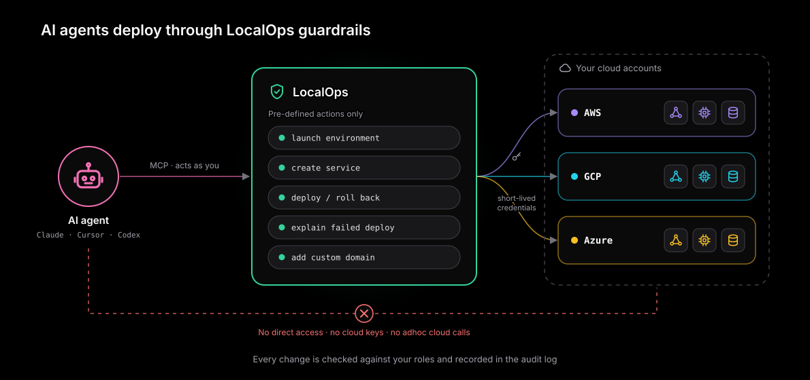

The LocalOps MCP server connects AI agents such as Claude, Cursor, VS Code and Codex to your LocalOps account. You ask
in plain language, and the agent looks things up and makes changes for you.

The agent acts **as you**. It sees the same organizations, projects and environments you do, with your
[roles](/team/understanding-roles), and it follows the same [SSO](/mcp/access#single-sign-on-sso) and
[billing](/mcp/access#billing) rules as the console.

## Safe deployments through guardrails

Agents never touch your cloud account directly. They talk to LocalOps, and LocalOps talks to your cloud:

- **No cloud keys for agents** - the agent never holds AWS or GCP credentials. There's nothing to paste into a chat or
  leak from one.
- **Keyless, short-lived access** - LocalOps itself holds no static keys either. Each run gets temporary credentials on
  the role you created when connecting the account, and you can revoke it any time.
- **No adhoc cloud calls** - agents can only do what LocalOps does, like launch environments and deploy services. They
  can't make arbitrary calls to your cloud's APIs.
- **Production-grade by default** - everything they launch gets the same setup as the console: its own VPC and cluster,
  encryption, least-privilege IAM and secrets kept in your cloud. See [Environment security](/environment/security).
- **Protected production** - keep production in a [protected environment](/environment/protected-environments) and
  only the people you add, and their agents, can touch it.
- **Never sees secret values** - only their names.

## What it can do

- Show your organizations, projects, environments, services and deployments
- Create environments and services
- Change a service's config, autoscaling and secrets
- Deploy a service, roll it back to an earlier version, or cancel a deployment
- Explain why a deployment failed
- Add and verify custom domains

See the [full list of tools](/mcp/tools).

## What it can't do

- Delete anything: services, environments or secrets
- Read the runtime logs of a running service (it reads deployment logs only)
- Create services from Helm charts (it can deploy existing ones)
- Change billing, members, roles, cloud connections or SSO

Use the [LocalOps console](https://console.localops.co) for these.

## Example prompts

- "Why did last night's deploy of api fail?"
- "Deploy tag v1.4 of the web service to staging."
- "Roll back web in production to the previous version."
- "Create an environment in us-west-2 for New Dept in the Customers project."
- "Add STRIPE_KEY to the payments service, then redeploy it."
- "Which services in production are not running?"

## Next steps

<CardGroup cols={2}>
  <Card title="Connect your client" icon="plug" href="/mcp/connect">
    Add the server to Claude, Cursor, VS Code or Codex.
  </Card>
  <Card title="Security" icon="shield" href="/mcp/security">
    How access works and how to keep agents safe.
  </Card>
</CardGroup>
