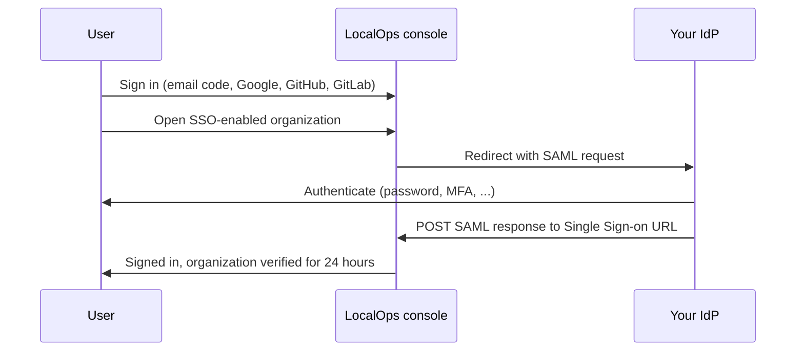

With single sign-on, people in your organization verify through your identity provider (IdP) before they can open it in
the LocalOps console. LocalOps supports **SAML 2.0**. OIDC is coming soon.

<Note>SSO is available for all accounts. Only Owners and Admins can set it up.</Note>

## How it works

- **One SSO provider per organization.** The provider is tied to your organization's slug, so the sign-in URL you give
  your IdP is unique to that organization.
- **Your IdP handles authentication, LocalOps handles access.** SSO doesn't add anyone to your organization. People
  still join through an [invitation](/team/invite-users), and their organization and project roles are managed in
  LocalOps. IdP groups and roles aren't read, and there's no SCIM or just-in-time provisioning.
- **SSO is enforced once your domain is verified.** After you verify the email domain (for example `acme.com`), everyone
  in the organization - Owners and Admins included - has to sign in through the IdP to open the organization in the
  console.
- **SSO sits on top of a normal LocalOps sign-in.** People sign in to LocalOps as usual (email code, Google, GitHub or
  GitLab). When they pick an SSO-enabled organization, they're sent to your IdP and then brought back. Organizations
  that need SSO have an **SSO** badge on the organization picker.
- **IdP-initiated sign-in works too.** Clicking the LocalOps tile in Okta, Microsoft My Apps or Google signs the person
  in to LocalOps and verifies SSO in one step.

## Set up SSO

<Steps>
  <Step title="Open Security settings">
    In the sidebar, under **Organization**, go to **Settings** → **Security** and click **Add provider**. **SAML 2.0**
    is selected.
  </Step>
  <Step title="Copy the service provider details">
    The **Service provider details** box shows the two values your IdP needs:

    | Field in LocalOps               | Looks like                                                                   |
    | ------------------------------- | ---------------------------------------------------------------------------- |
    | **Single Sign-on URL**          | `https://console.localops.co/api/v1/auth/sso/saml2/callback/<org-slug>`      |
    | **Audience URI (SP Entity ID)** | `https://console.localops.co/api/v1/auth/sso/saml2/sp/metadata`              |

    Keep this page open.

  </Step>
  <Step title="Create the SAML app in your IdP">
    Follow the steps for your IdP below - [Microsoft Entra ID](#microsoft-entra-id), [Okta](#okta),
    [Google Workspace](#google-workspace) or [another SAML IdP](#other-saml-identity-providers). Assign the people who
    should use LocalOps, **including yourself**.
  </Step>
  <Step title="Paste the IdP details into LocalOps">
    Back in LocalOps, fill in:

    - **Domain** - your company email domain, for example `acme.com`
    - **Identity Provider Single Sign-On URL** - the IdP's SAML sign-in URL
    - **Identity Provider Issuer** - the IdP's entity ID
    - **X.509 Certificate** - the IdP's signing certificate, including the `-----BEGIN CERTIFICATE-----` and
      `-----END CERTIFICATE-----` lines

    Click **Save configuration**.

  </Step>
  <Step title="Verify your domain">
    LocalOps shows a DNS record to add for your domain:

    | Record type | Host                    | Value                              |
    | ----------- | ----------------------- | ---------------------------------- |
    | `TXT`       | `_ops-dv-<org-slug>`    | `_ops-dv-<org-slug>=<token>`       |

    Add it with your DNS provider, wait for it to propagate, then click **Verify domain**. The provider then shows as
    **Verified**, and SSO is enforced for everyone in the organization within about 2 minutes.

    You can click **Skip for now** and verify later from **Settings** → **Security** - click the **Unverified** badge on
    the provider. The token is valid for 7 days. If it expires, click **Request new token** and update the TXT record.

  </Step>
</Steps>

<Warning>
  Verifying the domain turns SSO on right away, for you too. Before you click **Verify domain**, make sure you're
  assigned to the app in your IdP and the IdP details are correct. Otherwise you can lock yourself out of the console.
</Warning>

To check your setup, sign out, sign back in and open the organization. You should be sent to your IdP and then back to
the dashboard.

## Microsoft Entra ID

<Steps>
  <Step title="Create an enterprise application">
    In the [Microsoft Entra admin center](https://entra.microsoft.com), go to Enterprise apps → New application → Create
    your own application. Name it `LocalOps`, choose the non-gallery option and click Create.
  </Step>
  <Step title="Configure SAML">
    Open Single sign-on → SAML. Under Basic SAML Configuration, click Edit, fill in these fields and save:

    | Entra field                                 | Value from LocalOps         |
    | ------------------------------------------- | --------------------------- |
    | Identifier (Entity ID)                      | Audience URI (SP Entity ID) |
    | Reply URL (Assertion Consumer Service URL)  | Single Sign-on URL          |

  </Step>
  <Step title="Check the user identifier">
    Under Attributes & Claims, the Unique User Identifier (Name ID) defaults to `user.userprincipalname`. If your users'
    UPNs aren't their email addresses (for example `jane@acme.onmicrosoft.com` instead of `jane@acme.com`), change it to
    `user.mail` with the Email address format. LocalOps signs users in by this value, so it has to match the email they
    were invited with.
  </Step>
  <Step title="Copy the IdP details">
    Under SAML Certificates, download Certificate (Base64) and open it in a text editor. Then copy these into LocalOps:

    | From Entra                     | Into LocalOps                        |
    | ------------------------------ | ------------------------------------ |
    | Login URL                      | Identity Provider Single Sign-On URL |
    | Microsoft Entra Identifier     | Identity Provider Issuer             |
    | Certificate (Base64) contents  | X.509 Certificate                    |

  </Step>
  <Step title="Assign users">
    Go to Users and groups → Add user/group and assign the users or groups that use LocalOps.
  </Step>
</Steps>

<Tip>
  The certificate Entra creates expires after 3 years. Before it does, create a new one in Entra and paste it into
  LocalOps - click the pencil icon on the provider in Settings → Security and update X.509 Certificate.
</Tip>

## Okta

<Steps>
  <Step title="Create an app integration">
    In the Okta Admin Console, go to Applications → Applications → Create App Integration, choose SAML 2.0 and click
    Next. Name it `LocalOps` and click Next.
  </Step>
  <Step title="Configure SAML">
    Fill in these fields:

    | Okta field                  | Value                                   |
    | --------------------------- | --------------------------------------- |
    | Single sign-on URL          | Single Sign-on URL from LocalOps        |
    | Audience URI (SP Entity ID) | Audience URI (SP Entity ID) from LocalOps |
    | Name ID format              | `EmailAddress`                          |
    | Application username        | `Email`                                 |

    Keep "Use this for Recipient URL and Destination URL" checked. Optionally, under Attribute Statements, map `email` →
    `user.email`, `givenName` → `user.firstName` and `surname` → `user.lastName` so names show up properly in LocalOps.
    Click Next, then Finish.

  </Step>
  <Step title="Copy the IdP details">
    On the app's Sign On tab, open View SAML setup instructions. Copy the Identity Provider Single Sign-On URL,
    Identity Provider Issuer and X.509 Certificate into the LocalOps fields with the same names.
  </Step>
  <Step title="Assign users">
    On the Assignments tab, click Assign → Assign to People or Assign to Groups.
  </Step>
</Steps>

## Google Workspace

<Steps>
  <Step title="Add a custom SAML app">
    In the [Google Admin console](https://admin.google.com), go to Apps → Web and mobile apps → Add app → Add custom SAML
    app. Name it `LocalOps` and click Continue.
  </Step>
  <Step title="Copy the IdP details">
    Copy these into LocalOps, then click Continue:

    | From Google | Into LocalOps                        |
    | ----------- | ------------------------------------ |
    | SSO URL     | Identity Provider Single Sign-On URL |
    | Entity ID   | Identity Provider Issuer             |
    | Certificate | X.509 Certificate                    |

  </Step>
  <Step title="Configure the service provider">
    Fill in these fields, then click Continue and Finish:

    | Google field   | Value                                     |
    | -------------- | ----------------------------------------- |
    | ACS URL        | Single Sign-on URL from LocalOps          |
    | Entity ID      | Audience URI (SP Entity ID) from LocalOps |
    | Name ID format | `EMAIL`                                   |
    | Name ID        | Basic Information → Primary email         |

  </Step>
  <Step title="Turn the app on">
    New custom apps are off for everyone. Open the app, click User access and turn it on for everyone or for the groups
    and organizational units that use LocalOps.
  </Step>
</Steps>

## Other SAML identity providers

Any IdP that supports SAML 2.0 works - OneLogin, JumpCloud, Ping Identity, Keycloak, AD FS and so on. Create a SAML app
and map these fields:

| In your IdP                              | Value                                            |
| ---------------------------------------- | ------------------------------------------------ |
| ACS URL / Reply URL / Single sign-on URL | Single Sign-on URL from LocalOps                 |
| Audience / SP Entity ID                  | Audience URI (SP Entity ID) from LocalOps        |
| Name ID                                  | The user's email address (format `emailAddress`) |
| Binding                                  | HTTP-POST                                        |

| From your IdP                      | Into LocalOps                        |
| ---------------------------------- | ------------------------------------ |
| SAML sign-in URL / SSO URL         | Identity Provider Single Sign-On URL |
| IdP Entity ID / Issuer             | Identity Provider Issuer             |
| Signing certificate (PEM / Base64) | X.509 Certificate                    |

LocalOps reads the email from an `email` attribute if your IdP sends one, and from the Name ID otherwise. It reads the
name from `givenName` and `surname`, or `displayName`.

## Onboard users

<Steps>
  <Step title="Give them access in your IdP">
    Assign them to the LocalOps app (or add them to an assigned group). Skip this if your app is open to everyone in
    your directory.
  </Step>
  <Step title="Invite them to LocalOps">
    [Invite them](/team/invite-users) with the **same email address your IdP sends** for them, and pick their
    organization role and project access.
  </Step>
  <Step title="They accept and sign in">
    They accept the invitation, then open the organization and are sent to your IdP. Or they can click the LocalOps tile
    in your IdP's app launcher, then accept the invitation.
  </Step>
</Steps>

## Offboard users

Do both:

1. **Remove them in LocalOps.** In **Settings** → **Members**, [remove the member](/team/remove-user). This cuts off
   access right away - in the console, the CLI and the API.
2. **Remove them in your IdP.** Unassign or deactivate them so they can't sign in through SSO again.

<Warning>
  Deactivating a user only in your IdP isn't enough. Their LocalOps session stays valid for up to 24 hours in the
  browser and until it expires in the CLI (up to 7 days), because LocalOps doesn't receive deprovisioning events from
  your IdP. Removing the member in LocalOps is what revokes access immediately.
</Warning>

## Session duration

| What                                 | How long                                                                                                  |
| ------------------------------------ | --------------------------------------------------------------------------------------------------------- |
| LocalOps session (browser and CLI)   | Ends after **2 days** without activity, and extends while in use. Hard limit of **7 days** after sign-in. |
| SSO verification for an organization | **24 hours** from the IdP sign-in. Activity doesn't extend it.                                            |
| Domain verification token            | **7 days**                                                                                                |

When SSO verification expires, the console takes you to the organization picker. Pick the organization again and you're
sent through your IdP. If you're still signed in to your IdP, this is usually a quick redirect with no prompt.

Signing out of LocalOps clears SSO verification for every organization. Signing out of your IdP doesn't sign you out of
LocalOps - SAML single logout isn't supported.

## CLI and API access

SSO is checked for browser sessions in the console. The [CLI](/cli/usage) signs in with `ops login`, which opens the
browser to approve the device and then uses its own token. That token isn't checked against your IdP:

- `ops login` and CLI commands keep working for members of an SSO-enabled organization without a trip through the IdP.
- A CLI token lasts as long as a [LocalOps session](#session-duration) - up to 7 days. Run `ops login` again after it
  expires.
- Organization and project roles still apply, and removing a user from the organization stops their CLI access right
  away. This is why [offboarding](#offboard-users) needs both steps.

## Microsoft Entra ID and Okta FAQ

<AccordionGroup>
  <Accordion title="Do we need one Entra (or Okta) app per LocalOps organization?">
    Yes. Each LocalOps organization has one SSO provider, and its **Single Sign-on URL** ends with that organization's
    slug. Create one enterprise application in Entra (or one app integration in Okta) for each LocalOps organization.
    Most companies have a single LocalOps organization, so that's one app.
  </Accordion>
  <Accordion title="Should members be assigned to the app, or should it be open to everyone and access managed in LocalOps?">
    Access is always decided in LocalOps. Your IdP only proves who a user is. Nobody gets into your organization
    unless they've been invited, and their roles come from LocalOps, not IdP groups. So both setups are safe:

    - **Assign users or groups (recommended).** In Entra, set **Properties** → **Assignment required?** to **Yes** and
      assign users or groups. Okta always requires assignment. This gives you two gates, and unassigning a user in the
      IdP stops them from signing in through SSO.
    - **Open to everyone in the directory.** In Entra, set **Assignment required?** to **No**. In Okta, assign the
      **Everyone** group. Anyone in your directory can authenticate, but only invited members get into the LocalOps
      organization. Uninvited people who sign in see no organization.

    Either way, [offboarding](#offboard-users) still means removing the member in LocalOps.

  </Accordion>
  <Accordion title="Can we map Entra or Okta groups to LocalOps roles?">
    Not yet. Organization and project roles are set in LocalOps when you [invite](/team/invite-users) a user or change
    their role later.
  </Accordion>
</AccordionGroup>

## Edit or remove the provider

In **Settings** → **Security**, use the pencil icon on the provider to update the IdP sign-in URL, issuer or
certificate, and the trash icon to remove it. Removing the provider (**Remove SSO provider**) turns SSO off for the
organization, and people go back to signing in with just their LocalOps sign-in method.

<Warning>Changing the **Domain** resets verification, and SSO isn't enforced until you verify the new domain.</Warning>

## Gotchas

- **Emails must match.** LocalOps finds the user by the email your IdP sends. If a user joined LocalOps as
  `jane@gmail.com` but your IdP sends `jane@acme.com`, they're signed in as a different user who isn't in your
  organization. Invite people with their IdP email.
- **Everyone needs an email on the verified domain.** A member whose LocalOps email isn't on your SSO domain (a
  contractor's personal address, for example) can't complete SSO and won't be able to open the organization in the
  console. Give them an account in your IdP and invite that email instead.
- **Only the Admin who added the provider can verify the domain.** If they've left, remove the provider and add it
  again.
- **Nothing is enforced until the domain is verified.** An **Unverified** provider doesn't affect sign-in.
- **Owners and Admins aren't exempt.** If your IdP certificate expires or the IdP details change, nobody can open the
  organization in the console. Rotate certificates ahead of time. If you're locked out, contact
  [support@localops.co](mailto:support@localops.co).
- **Multiple SSO organizations.** Each SSO sign-in starts a new LocalOps session. If you belong to more than one
  SSO-enabled organization, switching between them sends you through the IdP again.
- **Changes take up to 2 minutes.** Turning SSO on or off can take up to 2 minutes to apply everywhere.
- **Clock skew.** SAML responses are accepted with up to 5 minutes of clock difference. A replayed response is rejected.
