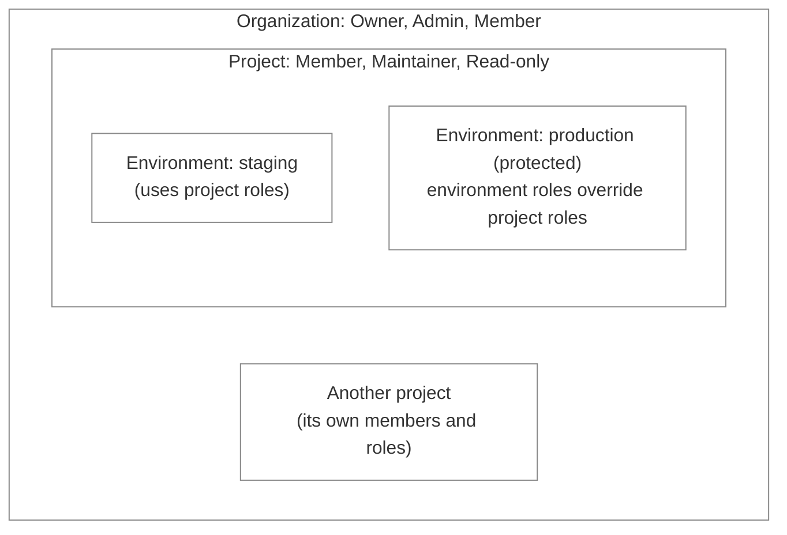
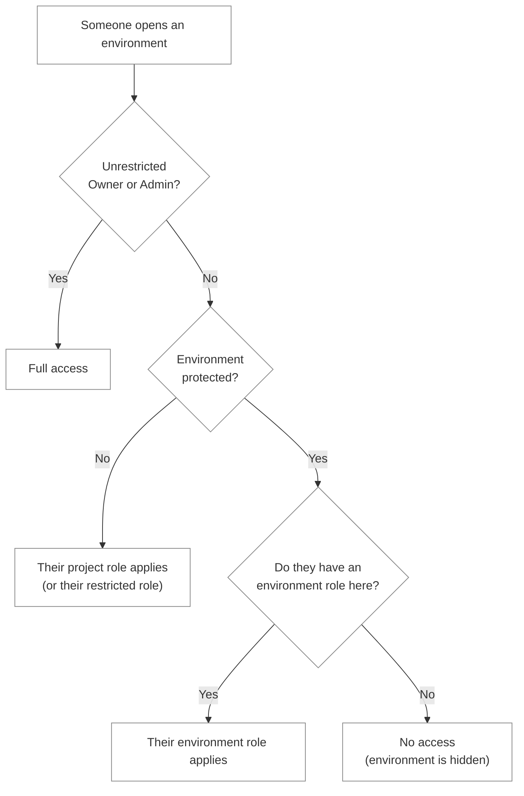

Access in LocalOps works in three layers:

1. **Organization roles** - Owner, Admin or Member - decide what someone can do across your whole LocalOps account.
2. **Project roles** - Member, Maintainer or Read-only - decide what someone can do inside a project.
3. **Protected environments** can give someone a different role on one environment, overriding their project role there.

## Organization roles

Pick an organization role when you [invite someone](/team/invite-users) to your LocalOps account.

### Owner

- Has **unrestricted access** to all features and settings, including billing.
- Has full access to every project, unless [restricted](#owners-and-admins-in-a-project) in a specific project.

### Admin

- Can do **everything the Owner can**, except manage billing.
- Has full access to every project, unless [restricted](#owners-and-admins-in-a-project) in a specific project.
- Ideal for team leads who need full operational control without billing oversight.

### Member

- Sees **only the projects they've been added to**.
- What they can do in each project depends on their [project role](#project-roles).
- Can't access projects they aren't part of.

Organization-level pages follow the organization role only - project roles and restrictions don't change them.
Organization Members can see cloud connections, registries, license tokens, connected GitHub and GitLab accounts, the
[audit log](/team/audit-logs) and who's in the organization, but only Owners and Admins can change them. Helm charts and integrations such as Slack are
for Owners and Admins only, to view as well as to manage, because Helm charts carry configuration values. Billing is for
the Owner.

## Project roles

Every organization Member in a project has one of three project roles.

| Role           | Who it's for                              | What they can do                                                                                     |
| -------------- | ----------------------------------------- | ---------------------------------------------------------------------------------------------------- |
| **Member**     | Developers and leads who own the project  | Everything in the project: create and change environments and services, manage secrets and members   |
| **Maintainer** | Developers and on-call engineers who ship | Deploy, roll out, retry, switch branches and read logs - but not change configuration or see secrets |
| **Read-only**  | Stakeholders, support, auditors           | See environments, services and deployments - but not deploy, see secrets or read logs                |

### Permissions in detail

✅ allowed · ✕ shown, but greyed out · **Hidden** not shown at all

#### Project

| Action                                                     | Member | Maintainer | Read-only |
| ---------------------------------------------------------- | ------ | ---------- | --------- |
| See the project - environments, services, deployments, Ops | ✅     | ✅         | ✅        |
| See project Settings → General                             | Hidden | Hidden     | Hidden    |
| Rename or delete the project                               | Hidden | Hidden     | Hidden    |

#### Project members

| Action                                     | Member | Maintainer | Read-only |
| ------------------------------------------ | ------ | ---------- | --------- |
| See the member list in Settings → Members  | ✅     | ✅         | ✅        |
| Add an existing organization member        | ✅     | ✕          | ✕         |
| Change a member's project role             | ✅     | ✕          | ✕         |
| Remove a member from the project           | ✅     | ✕          | ✕         |
| Restrict an Owner or Admin in this project | ✅     | ✕          | ✕         |
| Change your own role in this project       | ✅     | ✕          | ✕         |
| Leave the project                          | ✅     | ✅         | ✅        |
| Invite a new user to the organization      | ✕      | ✕          | ✕         |
| Cancel a pending invite                    | Hidden | Hidden     | Hidden    |

#### Environments

| Action                                                  | Member | Maintainer | Read-only |
| ------------------------------------------------------- | ------ | ---------- | --------- |
| See environment settings and node groups                | ✅     | ✅         | ✅        |
| Create an environment                                   | ✅     | ✕          | ✕         |
| Change settings, refresh, import or delete              | ✅     | ✕          | ✕         |
| Change node groups                                      | ✅     | ✕          | ✕         |
| Protect an environment and manage its environment roles | ✅     | ✕          | ✕         |
| Generate a Helm chart                                   | ✕      | ✕          | ✕         |
| Environment CLI (kubeconfig)                            | ✅     | Hidden     | Hidden    |

Generating a Helm chart is for Owners and Admins only, since a chart carries the environment's configuration values.

#### Services

| Action                                                                    | Member | Maintainer                      | Read-only |
| ------------------------------------------------------------------------- | ------ | ------------------------------- | --------- |
| See service settings, scaling, start/stop, IP allowlist, domains, backups | ✅     | ✅                              | ✅        |
| Create or delete a service                                                | ✅     | ✕                               | ✕         |
| Change settings, scaling, start/stop, IP allowlist, domains, backups      | ✅     | ✕                               | ✕         |
| Deploy, redeploy or promote                                               | ✅     | ✅                              | ✕         |
| Cancel a deployment or retry an operation                                 | ✅     | ✅                              | ✕         |
| Change the git branch                                                     | ✅     | ✅                              | ✕         |
| Operation and deployment logs                                             | ✅     | ✅                              | ✕         |
| Helm values and `ops.json`                                                | ✅     | Hidden                          | Hidden    |
| See secret names                                                          | ✅     | ✅                              | Hidden    |
| See secret values                                                         | ✅     | Hidden                          | Hidden    |
| Add, edit or delete secrets                                               | ✅     | ✕                               | Hidden    |
| Service CLI - regular services                                            | ✅     | ✅ (install, log in, tail logs) | Hidden    |
| Service CLI - Helm chart services                                         | ✅     | Hidden                          | Hidden    |

When an action is greyed out, LocalOps shows "Your role in this project doesn't allow this."

The `ops` CLI follows the same roles: `ops logs` needs Maintainer, while `ops connect`, `ops proxy` and
`ops update-kubeconfig` need Member. See [who can run which command](/cli/usage#who-can-run-which-command).

### Managing project members

Project Members manage who else is in the project, from the project's **Settings → Members**: they add existing
organization members, set or change their project role, and remove them. Anyone can leave a project on their own. See
[Project members](/team/project-members) for the steps.

Inviting someone who isn't in your organization yet, and cancelling pending invites, is done by Owners and Admins. See
[Invite team members](/team/invite-users).

## Owners and Admins in a project

Owners and Admins have full access to every project. To scale that back in a particular project - say, to keep an Admin
from accidentally changing production config - an Owner, Admin or project Member can **restrict** them to Member,
Maintainer or Read-only in that project. They then act with that role there.

Owners and Admins can't be removed from a project, only restricted. A restricted Owner or Admin still keeps a few
organization-level abilities in that project:

| Restricted Owner or Admin                   | Can they?                                                   |
| ------------------------------------------- | ----------------------------------------------------------- |
| See project Settings → General              | ✅ Yes, but renaming and deleting the project is greyed out |
| Invite new users to the organization        | ✅ Yes, and cancel pending invites                          |
| Change their own role in the project        | ✅ Yes, to any role                                         |
| Lift their own restriction                  | ✅ Yes                                                      |
| Lift another Owner's or Admin's restriction | ✕ Only an unrestricted Owner or Admin can                   |
| Leave the project                           | ✕ Owners and Admins stay in every project                   |

Restrictions can only be tightened afterwards. To restrict someone who is already restricted, pick a lower role. To give
them more access, lift the restriction instead. See [Owner and Admin restrictions](/team/owner-admin-restrictions) for
the full rules, including restrictions on a single protected environment.

<Note>
  A restricted Owner or Admin can lift their own restriction at any time. Restricting is a guard against mistakes, not a
  security boundary - to truly limit someone's access, give them the organization Member role instead.
</Note>

## Protected environments

Some environments need tighter control than the rest of the project. Mark an environment as **protected** - production
is the usual one - and you can give people an **environment role** on it: Member, Maintainer or Read-only.

On a protected environment, a person's environment role **replaces** their project role, whether it's higher or lower.
People without an environment role can't see a protected environment at all - it's hidden from them - unless they're an
unrestricted Owner or Admin.

### Example

In the project **Payments**, `production` is protected and `staging` isn't:

| Person | Project role | Environment role on `production` | On `staging` | On `production` |
| ------ | ------------ | -------------------------------- | ------------ | --------------- |
| Priya  | Member       | Read-only                        | Member       | Read-only       |
| Dev    | Maintainer   | Member (on-call lead)            | Maintainer   | Member          |
| Sam    | Read-only    | -                                | Read-only    | No access       |

Priya builds freely in staging but can only look at production. Dev normally deploys only, but owns production while on
call. Sam has no environment role on production, so production is hidden from them; on staging their project role
applies.

### Protect an environment

Anyone who can change an environment's settings - unrestricted Owners and Admins, project Members, and Owners or Admins
restricted to Member - can protect it. If they don't have full access, they're added to it with their current role, so
they keep access. Once it's protected, managing its members needs the Member role in that environment, or full access.

1. Open the environment and click **Protect** at the top of the page, then confirm.
2. Go to the environment's **Members** tab, which appears once it's protected.
3. Add the people who need access to this environment, and pick an environment role for each.

Unrestricted Owners and Admins keep full access to protected environments too, unless they've been
[restricted in that environment](/team/owner-admin-restrictions#restrictions-in-a-protected-environment).

<Warning>
  Unprotecting an environment deletes every environment role in it, Owner and Admin restrictions included. Everyone goes
  back to their project role.
</Warning>

See [Protected environments](/environment/protected-environments) for adding people, changing their roles and who can
do what.

## Related

- [Invite team members](/team/invite-users)
- [Project members](/team/project-members)
- [Owner and Admin restrictions](/team/owner-admin-restrictions)
- [Protected environments](/environment/protected-environments)
- [Remove a user](/team/remove-user)
- [Audit log](/team/audit-logs)
