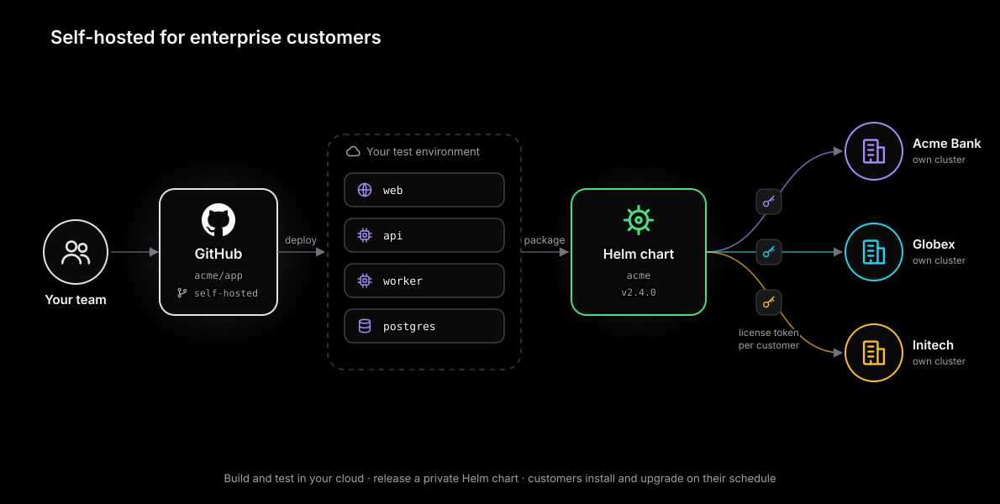

For teams offering self-hosted versions of their software, building & maintaining different version for their service,
while allowing customers to consume them at their own cadence can be challenging.

While SaaS model keeps all users on the latest version, enterprise companies have their own security policies to define
how software must be procured, installed, configured, managed and updated.

LocalOps makes distributing self-hosted versions easy for your team, with a modern/Git-ops style distribution pipeline
to build, generate and release pre-packaged versions of your service as Kubernetes helm charts. All while not writing
Dockerfiles, Yaml Specs, Terraform or Pulumi scripts.

### How self-hosted differs from BYOC

Both models run your software outside your own cloud. The difference is who operates it. In
[BYOC](/use-cases/byoc), LocalOps connects to the customer's cloud account and your team deploys and manages every
release. In self-hosted, you hand the customer a portable helm chart and they install and upgrade it on their own
Kubernetes cluster, with no access from you or LocalOps.

|                            | BYOC                                         | Self-hosted                                            |
| -------------------------- | -------------------------------------------- | ------------------------------------------------------ |
| **Where it runs**          | Customer's AWS, GCP or Azure account         | Customer's Kubernetes cluster, in any cloud or on-prem |
| **Who deploys & upgrades** | Your team, through LocalOps                  | Customer team (and your team in some contracts)        |
| **Access you need**        | A cross-account role in the customer's cloud | None                                                   |
| **What you ship**          | Continuous deployments from Git              | Versioned portable helm charts                         |
| **Update cadence**         | Yours                                        | The customer's                                         |
| **Best for**               | Data residency with a managed experience     | Strict security policies, air-gapped or on-prem        |

### Why deliver with portable helm charts

<CardGroup cols={1}>
  <Card title="For your customers" icon="building-shield">
    - **Own update cadence:** install new versions when their change windows allow, and roll back with `helm rollback`
      if needed.
    - **Runs anywhere, including bare metal:** install on any Kubernetes cluster, whether it's in the cloud, in their
      own data center on bare-metal servers, or on an air-gapped network with no cloud account involved.
    - **No vendor access:** nothing from your side connects to their cluster, which keeps security reviews short.
    - **Data stays in-house:** the app and its data run entirely in their infrastructure, including air-gapped and
      on-prem setups.
    - **Familiar tooling:** Helm and Kubernetes fit into the CI/CD, GitOps (Argo CD, Flux) and audit processes they
      already run.
    - **Configurable:** override chart values to match their networking, storage and sizing policies.
  </Card>
  <Card title="For your team" icon="code">
    - **One codebase:** build the self-hosted version from a Git branch, not a separate fork or packaging project.
    - **No packaging work:** LocalOps generates the chart from your running, tested environment. No hand-written
      Dockerfiles, Kubernetes YAML or Terraform.
    - **Versioned releases:** each chart has a version number, so you know exactly what each customer is running.
    - **Controlled distribution:** per-customer license tokens let you grant and revoke access to your charts.
    - **Branded installs:** customers install from an installation page on your own custom domain.
    - **Reach non-cloud buyers:** sell to enterprises that run on-prem or on bare metal, a market BYOC can't serve
      because it needs a cloud account.
    - **Less support load:** customers run a known, tested package instead of a custom install per account.
  </Card>
</CardGroup>

### Steps for software publishers/vendors

1. Sign up for LocalOps account
2. Create and connect your AWS/other cloud account
3. Spin up a new environment
4. Deploy services that are part of your software and link their github repo and branch (you could name this branch as
   `self-hosted`, spun from your `prod` branch.)
5. Test the setup
6. ✨ **Generate a new private helm chart from the running services**
7. Generate a license token for each customer
8. Distribute the installation URL and license token to your customer
9. Repeat steps 4-6 to release new chart versions as you make changes to your code and services.

<Steps>
  <Step title="Sign up">
    Sign up for LocalOps at https://console.localops.co/signup
  </Step>
  <Step title="Connect your cloud account">
    Connect your cloud account to LocalOps to create a test environment and test services.

    Refer to [Connect cloud account guide](/accounts/aws)
  </Step>
  <Step title="Spin up a new environment">
    To spin up a new environment, refer to this guide - [create environment](http://localhost:3000/environment/create)
  </Step>
  <Step title="Deploy services">
    For each service you have in your software, spin up a new service and deploy them in environment.

    1. To create a new service, refer to [Create service guide](/environment/services/create)
    2. To make deployments on the service, refer to
       [Deploy service guide](http://localhost:3000/environment/services/deploy)
    3. Repeat steps 1 and 2, for each service you have in your app - app, workers, web, etc.,

    <Tip>
      While using a Github repo and branch for each service, it is ideal to create a new branch called `self-hosted` or
      something similar and then use that for the services you spin up. Because you can then manage all self-hosted
      version code in its own branch.
    </Tip>
  </Step>
  <Step title="Test the setup">
    After adding all services, test them using the app url. One of our services will be the main entry point of your
    app. Use its public url to test the functionality.
  </Step>
  <Step title="Generate portable helm charts">
    <Note>
      Generating and distributing Helm charts, including license tokens and the account's custom domain, is done by an
      organization Owner or Admin. See [Understanding roles](/team/understanding-roles#organization-roles).
    </Note>

    Visit environment dashboard. On the top far right, click on "Generate chart". Give it a new name and new version
    number and click on generate.

    This will generate a Kubernetes helm chart for you and it can be used by your customers to install your service in
    their Kubernetes cluster.

    For the full walkthrough, see [Publish Helm charts with license tokens](/environment/services/publish-helm-charts).
    Chat with us from below or email us at support@localops.co and we will guide you here.
  </Step>
  <Step title="Generate a license token">
    In the LocalOps console, open the **License tokens** section and create a new license token for the customer. Create
    a separate token for each customer, so each one gets their own access to your charts.
  </Step>
  <Step title="Distribute portable helm charts">
    Open the **Helm charts** section from the left sidebar and click the chart you just generated. Turn on
    **Installation page url** to get a URL you can share.

    <Tip>
      Set a custom domain in account settings first, so the installation URL uses your brand's domain.
    </Tip>

    Hand over the installation URL and the customer's license token. With these, they can securely and privately pull
    and install your service as a Kubernetes helm chart in their own cluster.
  </Step>
</Steps>

Voila! You just offered your service as a self-hosted version. They can consume the chart and its updates in their
cadence from now.

### Day-1 and day-2 for helm chart operators

Once you hand over the installation URL and license token, your customer's team runs the chart. Their work splits into a
one-time install (day-1) and routine upgrades (day-2). The installation page has the exact commands and the
`values.yaml` for your chart.

#### Day-1: first install

1. **Update the helm repo** so the chart and its versions are available locally:

   ```sh
   helm repo update
   ```

2. **Authenticate with the license token**, as described on the installation page. The token authorizes pulls of the
   chart and its private images.
3. **Set secrets.** Create the Kubernetes secrets the chart expects. Each secret is listed in `values.yaml` with a
   description of what it holds.
4. **Install with `values.yaml`.** Adjust `values.yaml` for their cluster (networking, storage, sizing, security
   context) and install:

   ```sh
   helm install <release-name> <repo>/<chart> --version <version> -n <namespace> -f values.yaml
   ```

#### Day-2: upgrades

When you release a new chart version, upgrading is a short routine they run on their own schedule:

1. **Update the helm repo** to fetch the new version:

   ```sh
   helm repo update
   ```

2. **Add new secrets, if any.** Only needed when the new version introduces a secret that isn't set yet.
3. **Upgrade** with the same `values.yaml`:

   ```sh
   helm upgrade <release-name> <repo>/<chart> --version <new-version> -n <namespace> -f values.yaml
   ```

If something goes wrong, `helm rollback <release-name>` returns to the previous version.

### Get started now

<CardGroup cols={3}>
  <Card title="Sign up for free" icon="rocket" href="https://console.localops.co/signup">
    Create your account and connect your cloud to get started.
  </Card>
  <Card title="Book a demo call" icon="calendar" href="https://go.localops.co/tour">
    We'll walk you through the setup personally.
  </Card>
  <Card title="Email support" icon="envelope" href="mailto:support@localops.co">
    Questions? Write to us at support@localops.co.
  </Card>
</CardGroup>
